# Vault

A local, end-to-end encrypted password manager for desktop and mobile, built with Tauri 2, React, and Rust.


---

## Features

### Security
- **AES-256-GCM encryption**: every vault is encrypted at rest with an authenticated cipher, and nothing is ever stored in plaintext
- **Argon2id key derivation**: the master password is stretched with Argon2id before use, which makes brute-force attacks expensive
- **Secure key wiping**: the decryption key is zeroed from memory on lock using the `zeroize` crate
- **Auto-lock**: configurable inactivity timeout, from 1 minute to 1 hour, or never
- **Lock on screen lock or sleep**: the vault locks when the machine goes to sleep, and on Windows also when the screen locks (optional)
- **Lock in the background**: on iOS and Android, the vault locks as soon as the app leaves the foreground
- **Windows Hello quick unlock**: unlock with a fingerprint, face or PIN after the first unlock. Nothing is written to disk, so a cold start still needs the master password
- **Clipboard auto-clear**: copied secrets are wiped from the clipboard after 30 seconds by a system-level clear, which adds no blank history entry
- **Password health**: flags reused passwords, weak passwords, and passwords that haven't changed in over a year
- **Change master password**: re-encrypts the vault under a new password

### Entries
- **TOTP / 2FA codes**: store a base32 secret or paste an `otpauth://` URI. Live 6-digit codes with a countdown are shown in the detail view and in the overlay
- **Password generator**: random passwords, or memorable passphrases built from the EFF short wordlist, with a choice of separator, capitals and digits
- **Password history**: the last 10 passwords of each entry are kept, and any of them can be shown, copied or restored
- **Folders**: organise entries into folders, with rename and delete
- **Undo delete**: deleted entries can be restored from a toast for a few seconds
- **Email suggestions**: the email field suggests addresses you have already used

### Vaults and sync
- **Multiple vaults**: people sharing a device each keep their own vault, with its own master password and sync settings. Switch from the lock screen, the title bar or Settings; switching always locks the open vault first
- **Sync between devices (optional)**: through a sync folder or a WebDAV server. Changes from each device are merged entry by entry, so edits made offline on two devices both survive. See [Syncing between devices](#syncing-between-devices)
- **Import / Export**: encrypted vault backups, and CSV import from Chrome, Edge, Firefox, Bitwarden, LastPass and other password managers, including on first run before a vault exists
- **Fully local**: no Vault servers, accounts or telemetry. Sync only ever moves the encrypted vault file, through a folder or server you choose

### Desktop
- **Quick-access overlay**: press a global shortcut (default `Ctrl+Shift+P`) to open a floating search window, then copy fields with single keys
- **Configurable overlay shortcut**: change it in Settings → Shortcuts
- **System tray**: lives in the background; use the tray menu to open, lock, or quit
- **Autostart**: optional launch on system boot
- **Themes**: Ocean, Midnight, Forest, Crimson and Slate

### Mobile
- **Native-style phone layout** with tab navigation, tap-to-copy fields, and Android back-button support
- **iOS Password AutoFill**: Vault offers your logins in Safari and in other apps' sign-in fields (optional)

---

## Screenshots

### Lock Screen
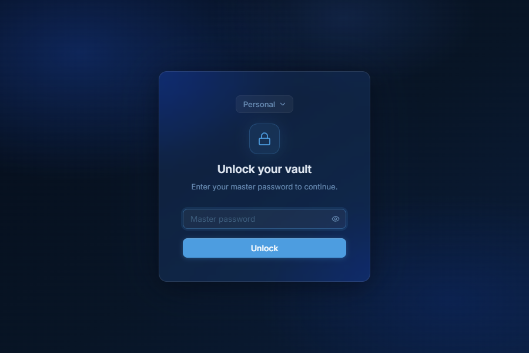

### Main Window
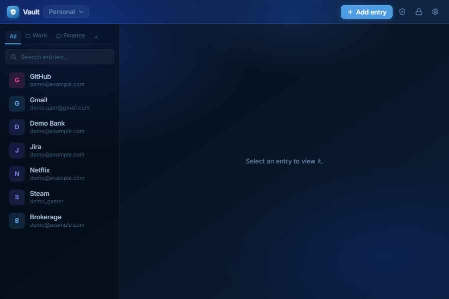
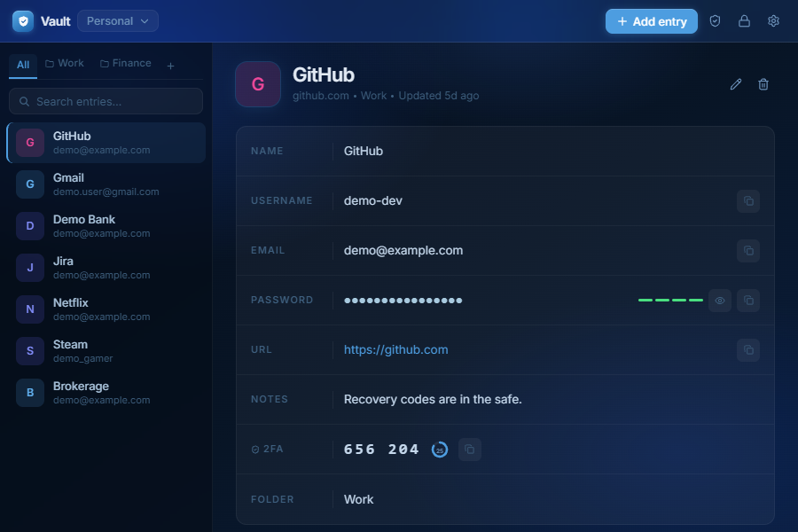

### Password Generator
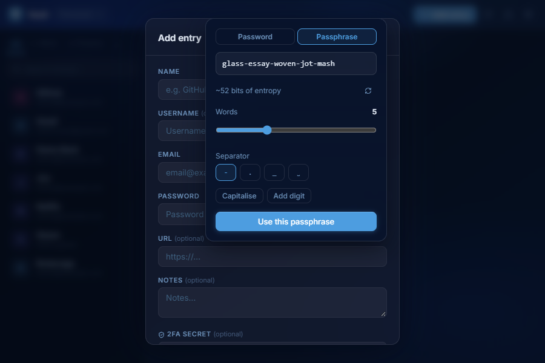

### Password Health
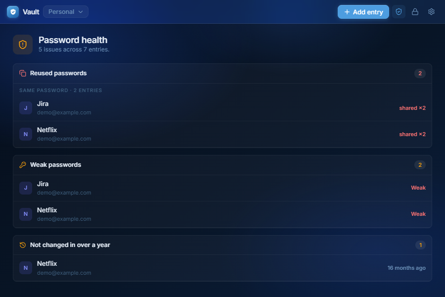

### Settings
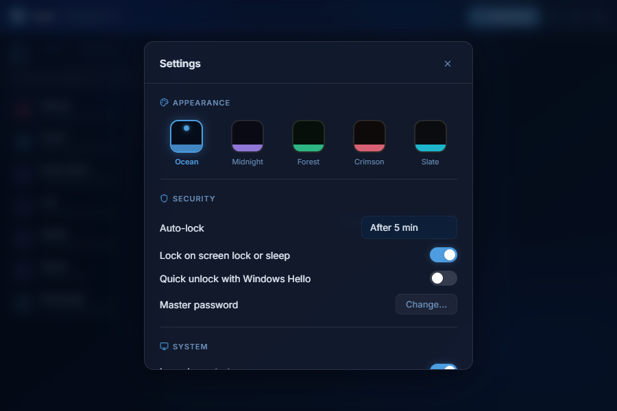
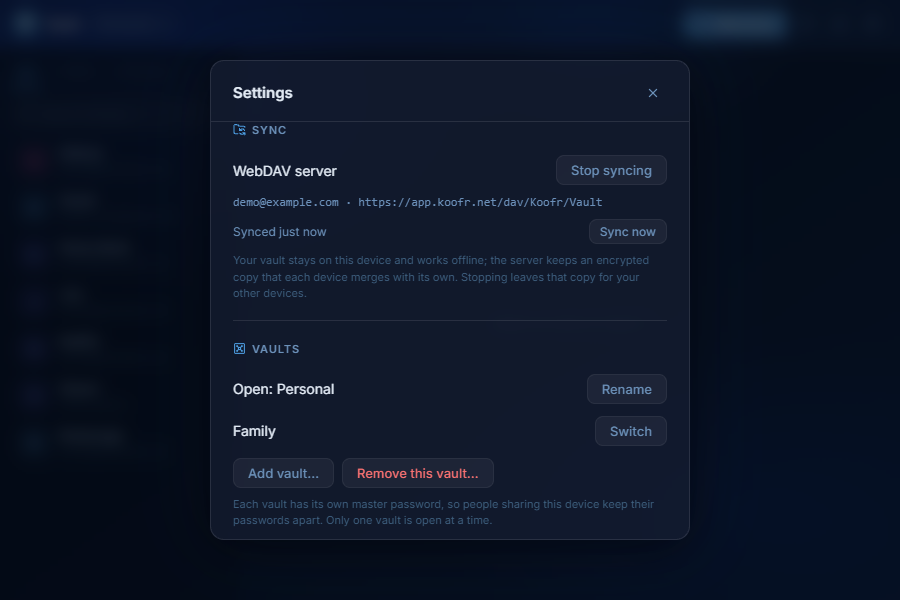

### Quick-Access Overlay
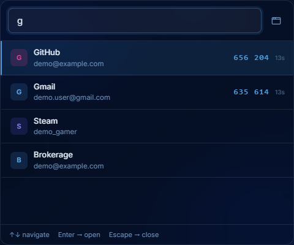
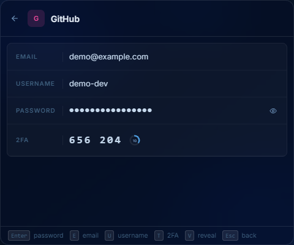

### Mobile
<p>
  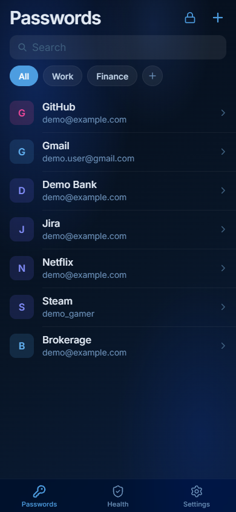
  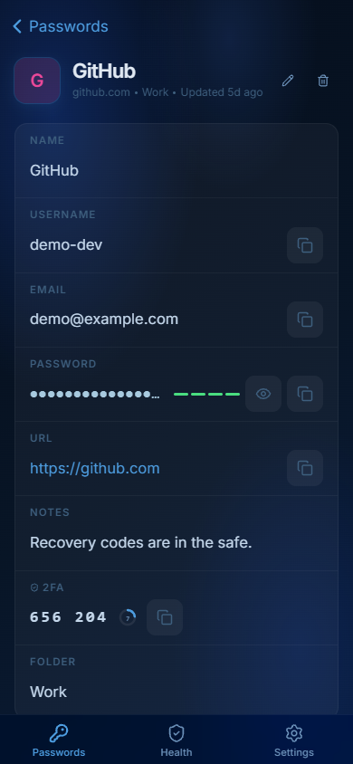
</p>

---

## Syncing between devices

Sync is optional and set per vault in Settings → Sync. Either way, only the encrypted vault file leaves the device. The master password and the decryption key never do.

**Sync folder (desktop only).** Keep the vault in a folder that OneDrive, Dropbox, iCloud Drive or Syncthing already keeps in step across your computers. Vault merges other devices' changes as they arrive and folds conflict copies back in automatically.

**WebDAV server (every platform, including iOS and Android).** Vault keeps an encrypted copy of the vault on a WebDAV server and merges it with each device's own copy. Any WebDAV provider works, for example Koofr, Nextcloud, or a NAS:

| Field | Example (Koofr) |
|---|---|
| Server folder | `https://app.koofr.net/dav/Koofr/Vault` |
| Username | your account email |
| Password | an app password created in the provider's account settings |

- Connect the first device from Settings → Sync. On each other device, choose **Open a vault from a WebDAV server…** on the lock screen, then enter the same master password.
- A save is uploaded about a second later, and each device checks for changes every 30 seconds while the vault is unlocked, and again on every unlock. Phones sync only while the app is open.
- The vault works offline and catches up the next time the server is reachable.
- The server must use HTTPS (plain HTTP is allowed only for `localhost`). The WebDAV password is stored on the device, encrypted under the vault key.
- If the master password is changed on one device, the others ask for the new one the next time they sync.

Merging is handled by [folder-crdt](https://github.com/Wilgoy23/folder-crdt): every field carries a hybrid-clock timestamp, so concurrent edits to different fields both survive, and the newest edit wins when two devices change the same field.

---

## Security Model

| Layer | Implementation |
|---|---|
| Key derivation | Argon2id, 64 MiB memory, 3 iterations |
| Encryption | AES-256-GCM (authenticated) |
| Salt | 32 random bytes, generated once per vault |
| Nonce | 12 random bytes, unique per save |
| Storage | A versioned header (format, salt, Argon2 parameters) followed by `nonce ‖ ciphertext` |
| Memory | Master key zeroed with `zeroize` on lock; key derivation and writes run off the UI thread |
| Clipboard | Cleared after 30 s; only Vault's own copy is cleared |
| Quick unlock | Windows Hello wraps the key in process memory only; nothing is stored on disk |
| Sync | Only the encrypted file is transferred; WebDAV requires HTTPS, and its credentials are sealed under the vault key |

The vault file cannot be decrypted without the master password. There is no recovery mechanism: if you forget your master password, the data is unrecoverable.

---

## Tech Stack

**Frontend**
- React 19 + TypeScript 5.8
- Vite 7
- Glassmorphism UI, with no external component library
- Vitest for unit tests

**Backend (Rust)**
- Tauri 2 (desktop, iOS and Android)
- `aes-gcm`: encryption
- `argon2`: key derivation
- `zeroize`: secure memory wiping
- [`folder-crdt`](https://github.com/Wilgoy23/folder-crdt): vault merging, sync folders, and the WebDAV client (`ureq` + `rustls`)
- `arboard`: desktop clipboard access
- `windows`: Windows Hello and screen-lock detection
- `csv`: importing exports from other password managers
- `uuid`, `serde_json`: entry identifiers and serialization

---

## Entry Fields

| Field | Required |
|---|---|
| Name | Yes |
| Email or username | At least one |
| Password | Yes |
| URL | No |
| Notes | No |
| 2FA secret | No |
| Folder | No |

---

## Installation

Download the latest build from the [Releases](../../releases) page.

| Platform | Files |
|---|---|
| Windows | `.exe` (NSIS installer, recommended) or `.msi` |
| macOS | `.dmg` |
| Linux | `.AppImage`, `.deb` or `.rpm` |
| iOS | `_iOS_unsigned.ipa`, to sideload with AltStore, Sideloadly or similar |
| Android | Build from source; see [ANDROID_BUILD.md](ANDROID_BUILD.md) |

---

## Building from Source

**Prerequisites**
- [Node.js](https://nodejs.org) 18+
- [Rust](https://rustup.rs) stable
- [Tauri prerequisites](https://tauri.app/start/prerequisites/) for your platform (on Windows: WebView2 and the MSVC build tools)

```bash
git clone https://github.com/Wilgoy23/vault.git
cd vault
npm install
npm run tauri build
```

Installers are output to `src-tauri/target/release/bundle/`.

For development hot-reload:

```bash
npm run tauri dev
```

Run the tests:

```bash
npm test                              # frontend
cargo test --manifest-path src-tauri/Cargo.toml   # backend
```

**Mobile**
- Android: see [ANDROID_BUILD.md](ANDROID_BUILD.md). Works on Windows, with `npm run tauri android dev` for a connected phone.
- iOS: see [IOS_BUILD.md](IOS_BUILD.md). Needs a Mac, or the GitHub Actions workflow that builds the unsigned `.ipa`.

---

## Keyboard Shortcuts

### Main Window

| Shortcut | Action |
|---|---|
| `Ctrl+Shift+P` | Toggle quick-access overlay (configurable) |
| `J` / `↓` | Select next entry |
| `K` / `↑` | Select previous entry |
| `/` or `Ctrl+F` | Focus search |
| `E` | Edit selected entry |
| `Escape` | Deselect entry |

### Overlay: Search List

| Shortcut | Action |
|---|---|
| `↑` / `↓` | Navigate results |
| `Enter` | Open entry detail |
| `Escape` | Close overlay |

### Overlay: Entry Detail

| Shortcut | Action |
|---|---|
| `Enter` / `P` | Copy password |
| `E` | Copy email |
| `U` | Copy username |
| `T` | Copy 2FA code |
| `V` | Toggle password visibility |
| `Escape` | Back to search |

---

## License

MIT
